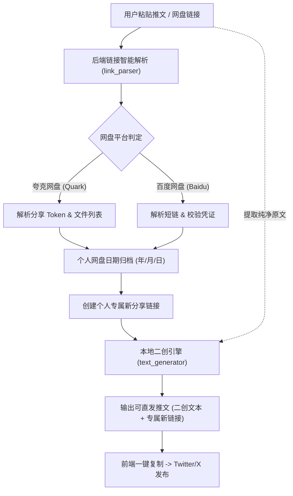

# 🚀 Pan-Transfer-Bot | 推特内容复刻与双网盘自动转存神器
### Twitter/X Content Replicator & Dual Cloud Drive Auto-Transfer Tool

<div align="center">

[](LICENSE)
[](https://www.python.org/)
[](https://fastapi.tiangolo.com/)
[](Dockerfile)
[](https://github.com/)

**[中文文档](#-中文说明文档) | [English Documentation](#-english-documentation)**

</div>

---

<a name="-中文说明文档"></a>
## 📖 中文说明文档

### 💡 项目简介

**Pan-Transfer-Bot** 是一款专为社交媒体内容创作者、资源矩阵博主与技术分享者打造的**自动化推特内容复刻与网盘转存工具**。

只需粘贴包含推文正文或网盘链接的内容，系统即可完成：
1. **自动识别网盘类型**（夸克网盘与百度网盘）。
2. **智能穿透短链与提取提取码**。
3. **全自动转存并按日期层级归档**（`年/月/日`），生成属于**博主个人专属**的永久公开分享链接。
4. **纯本地智能算法二创改写**：无需配置或调用任何外部商业 AI API（**零 API 成本、零封号风险、离线即用**），重塑句式、自动丰富 Emoji、提炼干货，生成可直接在 Twitter/X 一键发布的爆款文案！

---

### ✨ 核心特性

| 功能模块 | 核心优势 |
| :--- | :--- |
| ⚡ **零外部 AI 依赖** | 内置本地智能重写引擎与爆款排版算法，句式重构、近义词替换、爆款标签与 Emoji 装点，无需付费大模型 Key，秒级离线生成。 |
| 🔄 **双网盘原生兼容** | 深度集成 **夸克网盘**（`pan.quark.cn`）与 **百度网盘**（`pan.baidu.com`），支持各类防封短链/聚合中转链接的自动重定向穿透。 |
| 🔑 **智能提取码检测** | 自动从混杂文本、URL 参数（`?pwd=`）或常见格式（提取码: xxxx）中精准捕获密码，彻底杜绝人工复制遗漏。 |
| 📦 **个人专属链接替换** | 严格杜绝直接引用原作者链接；文件自动转存至个人网盘的日期归档目录，并生成属于你自己的专属有效公开分享链接。 |
| 💻 **浏览器 Cookie 一键抓取** | 支持一键自动扫描本机已登录的 Chrome / Edge 浏览器提取有效认证 Cookie，免去按 F12 抓包复制的烦恼。 |
| 🐳 **生产级容器化部署** | 提供完备的 `Dockerfile` 与 `docker-compose.yml`，一行命令即可在云服务器或 NAS 本地极速部署。 |
| 🎨 **赛博暗黑科技风前端** | 响应式现代化 Web 界面，支持状态监控、实时字符统计、一键复制、预设示例等。 |

---

### 🏗️ 架构与业务流转图



---

### 🚀 快速开始

#### 方法一：本地 Python 环境运行

**1. 克隆仓库并进入项目目录**
```bash
git clone https://github.com/hen9xin/pan-transfer-bot.git
cd pan-transfer-bot
```

**2. 安装依赖环境（推荐 Python 3.10+）**
```bash
python -m pip install -r requirements.txt
```

**3. 配置环境变量**
```bash
# 复制示例环境变量文件
cp .env.example .env

# 按需修改 .env（或启动后在 Web 界面点击右上角配置）
```

**4. 启动服务**
```bash
python app.py
```
启动成功后，浏览器访问：**`http://localhost:8000`** 即可使用。

---

#### 方法二：使用 Docker / Docker Compose 部署

**1. 准备配置文件**
```bash
cp .env.example .env
```

**2. 启动容器**
```bash
docker compose up -d --build
```

**3. 查看运行日志**
```bash
docker compose logs -f
```
访问：**`http://<服务器IP>:8000`**。

---

### 🔑 网盘 Cookie 配置指南

进入 Web 页面后，点击右上角 **「网盘 Cookie 配置」**：

1. **一键自动获取**：
   - 若在本地 Windows 主机运行，且已在 Chrome 或 Edge 浏览器中登录过网盘，点击 **「⚡ 一键从本机浏览器自动获取 Cookie」** 即可自动注入。
2. **夸克网盘手动配置**：
   - 登录 [pan.quark.cn](https://pan.quark.cn/)，按 `F12` 打开开发者工具，切换到 `Network` 标签页，刷新网页，选中任一请求，复制 `Request Headers` 中的 `Cookie`。
3. **百度网盘手动配置**：
   - 登录 [pan.baidu.com](https://pan.baidu.com/)，按 `F12` 切换至 `Network`，复制包含 `BDUSS=` 的 `Cookie`。

> 💡 **提示**：未配置 Cookie 时，仍可使用系统的“纯文案二创改写”功能；配置对应网盘 Cookie 后即可激活自动化转存与专属链接生成。

---

### 🔌 REST API 接口文档

#### 1. 链接与文本解析 `POST /api/parse`
- **请求体**：`{"text": "推文内容或网盘链接"}`
- **响应**：提取出的网盘类型、链接列表、分享 ID、识别提取码以及纯净正文。

#### 2. 一键转存与文案生成 `POST /api/generate`
- **请求体**：
```json
{
  "text": "推特原帖内容包含链接",
  "link": "",
  "passcode": "",
  "custom_title": "自定义分享标题(可选)",
  "quark_cookie": "",
  "baidu_cookie": ""
}
```
- **响应**：包含 `new_link`（你的专属分享链接）、`passcode`（提取码）、`rewritten_text`（二创文案）、`final_tweet`（组合好可直接发布的完整推文）。

#### 3. 配置读写与自动侦测
- `GET /api/settings`：获取当前已保存的网盘配置状态。
- `POST /api/settings`：持久化更新网盘 Cookie 与 API 基础地址。
- `POST /api/settings/auto-detect`：触发本机浏览器 Cookie 自动扫描提取。

---

<a name="-english-documentation"></a>
## 🌐 English Documentation

### 💡 Overview

**Pan-Transfer-Bot** is an automated workflow engine designed for social media creators, digital curators, and resource sharers on Twitter/X.

It accepts raw tweets or cloud drive links, automatically:
1. **Detects the cloud drive provider** (Quark Pan or Baidu Pan).
2. **Resolves shortlinks and extracts passcodes** using smart regex matching.
3. **Transfers content to your personal drive** organized by date (`YYYY/MM/DD`), creating a brand new, permanent public share link.
4. **Rewrites marketing copy locally**: No external LLM API required (**Zero API cost, zero quota limits, 100% offline-ready**). It structures sentences, adds fitting emojis, and formats an engaging post ready to be published on Twitter/X!

---

### ✨ Features

- ⚡ **Zero External AI Dependency**: Built-in deterministic secondary creation algorithm, eliminating external API costs and latency.
- 🔄 **Dual Cloud Storage Support**: Full compatibility with Quark Pan (`pan.quark.cn`) and Baidu Pan (`pan.baidu.com`).
- 🔑 **Intelligent Passcode Detection**: Automatically parses passcodes from messy text or URL parameters (`?pwd=`).
- 📦 **Re-sharing with Personal Links**: Automatically archives files to your cloud drive and replaces source links with your own dedicated share links.
- 💻 **One-Click Browser Cookie Detection**: Automatically extracts active login cookies from Chrome / Edge local storage.
- 🐳 **Containerized & Production Ready**: Includes production-grade `Dockerfile` and `docker-compose.yml`.
- 🎨 **Modern Cyberpunk UI**: Intuitive dark-themed responsive frontend.

---

### 🚀 Quick Start (English)

```bash
# Clone the repository
git clone https://github.com/hen9xin/pan-transfer-bot.git
cd pan-transfer-bot

# Install requirements
pip install -r requirements.txt

# Configure environment
cp .env.example .env

# Run the application
python app.py
```
Open **`http://localhost:8000`** in your browser.

**Docker Deployment:**
```bash
docker compose up -d --build
```

---

### 📁 Project Structure

```text
├── app.py                     # FastAPI backend application & API routing
├── config.py                  # Configuration loader (.env & settings.json)
├── requirements.txt           # Python package dependencies
├── Dockerfile                 # Production container image specification
├── docker-compose.yml         # Container orchestration configuration
├── .env.example               # Template environment configuration
├── .gitignore                 # Git ignore specifications
├── LICENSE                    # MIT License
├── README.md                  # Comprehensive bilingual project documentation
├── CONTRIBUTING.md            # Guidelines for open source contributors
├── SECURITY.md                # Security vulnerability disclosure policy
├── SKILL.md                   # AI Agent integration capability specification
├── services/
│   ├── __init__.py
│   ├── ai_rewrite.py          # Optional DeepSeek LLM rewriting service
│   ├── baidu.py               # Baidu Pan API client (verify, transfer, share)
│   ├── cookie_extractor.py    # Local browser storage cookie extractor
│   ├── link_parser.py         # Link pattern resolver & passcode extractor
│   ├── quark.py               # Quark Pan API client (token, save, share)
│   └── text_generator.py      # Deterministic local rewriting engine
└── static/
    ├── index.html             # Responsive sci-fi web user interface
    ├── script.js              # Frontend reactive client & API handlers
    └── style.css              # Cyberpunk UI styling and animations
```

---

### ⚠️ Disclaimer / 免责声明

1. 本项目仅供学习、技术研究与个人效率提升使用。
2. 请遵守 Twitter/X、夸克网盘以及百度网盘的相关平台服务协议与条款。
3. 请尊重数字资源版权，切勿利用本工具传播侵权或违法违规内容。
4. 使用者因操作不当或违反平台规定所产生的后果由使用者自行承担，与本项目开发者无关。

---

### 📄 License

This project is licensed under the [MIT License](LICENSE).
